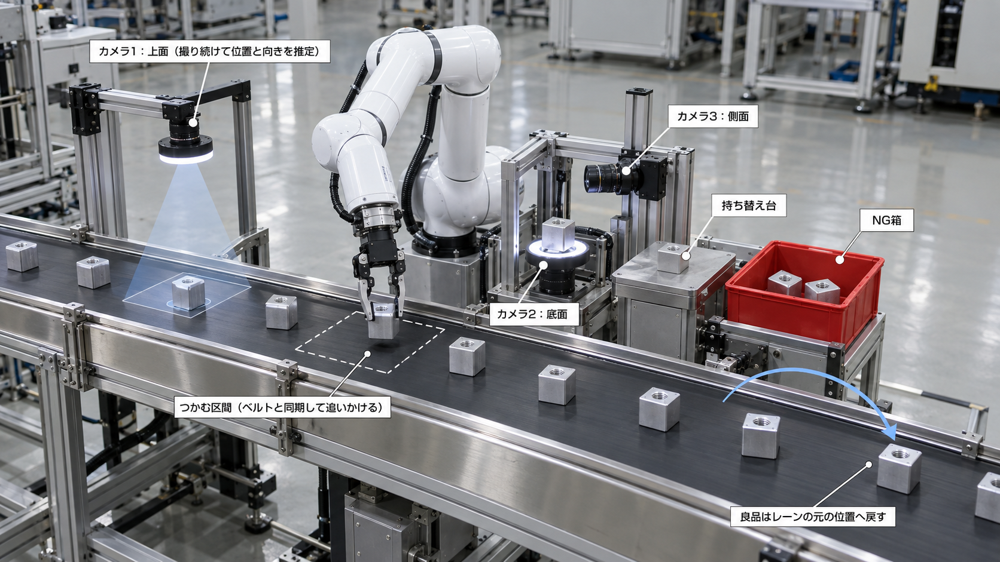
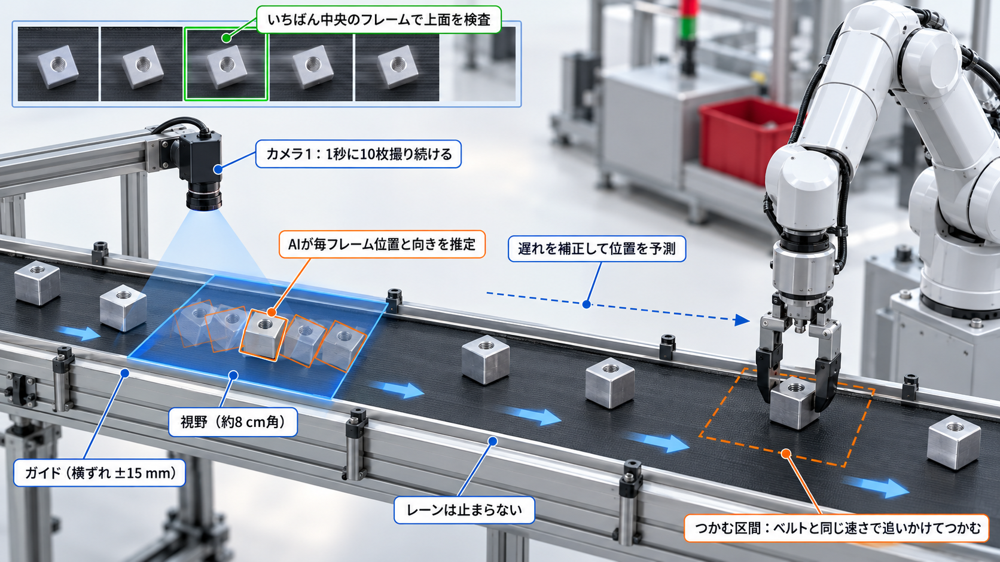

# ロボットによる6面外観検査ライン：止まらないレーンで、カメラとアームを同期させる（MuJoCo シミュレーション）

Physical AI 応用編1 最終課題。

## 締切後に追加した版（このブランチ `friction-grasp`）

提出した版は [`main`](https://github.com/takumaichida/pai-six-face-inspection/tree/main) ブランチです（2026-11-02 の締切前に提出）。
このブランチは締切後（2026-11-02）に追加したもので、提出物には含まれていません。提出した動画は `main` の内容です。

`main` からの変更：

- つかんだ部品を手先に固定する補助を外し、指で挟む力と摩擦だけで持つようにした。指先にゴムパッドを付けた想定で、指の摩擦係数は 2.5。
  シミュレーションの時間刻みを 2 ms から 0.5 ms にし、指の接触を硬めにした（2 ms では、挟んだ部品が指の面に沿って滑った）。
- 持ち上げた後と検査の区切りごとに、部品が手の中にあるかを確かめる。運ぶ間に部品が指の面に沿ってずれる分（最大約 1.3 cm）は、レーンへ戻すときに置く位置で補正する。
- 模倣学習のお手本を、摩擦の物理で集め直した（1,800 回）。手首の向きは、同じ2面をつかむ2通り（180°違い）を半々にした。
  片方の向きだけで学習した方策は、ライン上でもう片方の向きになった部品を取りこぼした（遅れの条件によって、24個中 20〜23 個）。
- ベルトが1ステップで進む分は、回転計の速さから方策の外で足し、方策はそこからの補正だけを出すようにした。
- 方策に切り替える前に、手先を部品の上空まで運び、手首の向きを合わせきるようにした。前の部品の検査が長引くと、上空に着く前に切り替わり、つかみ損ねることがあった（`main` にもある不具合）。

このブランチで測り直したもの：

- 下の「結果」の表と説明資料（`report/report.pdf`）の数字は、すべてこの版で測り直した値。
- 方策でつかむ評価：学習に使っていない引き継ぎ 170 回で 170 回、ライン全体では遅れ 0〜1.5 秒の各条件で 24 個中 24 個をつかめた。
- つかむ動作をすべて方策に任せ、判定AI・6面検査・仕分けまで通した確認（`scripts/check_policy_line.py`、6ロット48個、遅れ 0.3 秒・補正あり）：
  48個すべてを方策でつかみ、落下は0個。不良18個はすべて NG 箱へ、良品30個はすべてレーンへ戻した。

まだしていないこと：

- 動画は撮り直していない。

精密切削工場の出荷前工程を想定し、アルミ削り出しのセンサーハウジング（40 mm 角、ねじ穴 1 か所）の
**6面全数外観検査**を、止まらないコンベア・検査用カメラ3台・手先カメラ1台・ロボットアーム1台で自動化するラインを MuJoCo 上に構築しました。



## 何をしているか

1. **カメラ1が撮り続ける**：部品は止まらずに流れてくる（間隔・横ずれ ±15 mm・向きはばらばら）。カメラ1は1秒に10枚撮り、
   AI（ResNet-18）が毎フレーム部品の位置と向きを推定する。いちばん中央に写ったフレームで上面を検査する。
2. **カメラとアームを同期する**：各フレームに撮影した瞬間のベルトの回転計（エンコーダ）の値を付け、部品がベルトのどこに載っているかを求める。
   その後の位置は回転計で追う。推定がアームに届くまでの遅れ（推論＋通信）は、撮影時刻の値と組み合わせて打ち消す。
3. **追いかけてつかむ（模倣学習）**：カメラ1と回転計で部品の上空まで手を運び、そこから先は、模倣学習した方策が手先カメラの映像を見て、
   流れる部品を追いかけてつかむ。方策は次の1秒分の動きと指の開閉をまとめて出す（ACT と同じ行動チャンク）。ベルトが進む分は回転計の速さで足し、方策はそこからの補正を出す。
   お手本は、同じ動きをするプログラム（正しい部品位置を渡したもの）を自動で 1,800 回実行して集めた。指の開きと部品の位置で、つかめたかを確かめる。
4. **6面を見せる**：検査台でカメラ2が底面、カメラ3（横カメラ1台）が側面を撮る。手首（第7関節）だけを180°回して反対側も撮り、
   持ち替え台で90°つかみ直して、指で隠れていた2面も撮る。
5. **仕分け**：1面でも不良なら NG 箱へ。6面とも良なら、流れているレーンの元の位置へ追いかけて戻す。



## 結果

推定がアームに届くまでの遅れと、流れる部品をつかめた割合（各条件 24 個）：

| 遅れ（秒） | 0.0 | 0.3 | 0.6 | 1.0 | 1.5 |
|---|---|---|---|---|---|
| 補正あり | 100% | 100% | 100% | 100% | 100% |
| 補正なし | 100% | 92% | 0% | 4% | 0% |

検査方式の比較（止まらないレーン、48個・うち不良18個）：

| 方式 | 不良品の検出率 | 上面以外にだけ不良がある部品 | 良品の誤NG | つかみ成功率 |
|---|---|---|---|---|
| 上面だけ（カメラ1） | 11% | 0% | 0% | 100%（2/2） |
| 持ち上げのみ（持ち替えなし） | 61% | 56% | 0% | 100%（48/48） |
| **6面（持ち替えあり）** | **100%** | **100%** | 0% | 100%（48/48） |

上面だけの方式は、上面で不良が見つかった部品だけをつかんで NG 箱へ運ぶため、つかんだ回数が少なくなります。

AI の処理時間と撮影時刻の確認（`scripts/measure_timing.py`、開発に使った PC の CPU）：

| AI | 中央値 | p95 | 予算 |
|---|---|---|---|
| 位置・向きの推定（カメラ1の毎フレーム、816回） | 8.6 ms | 9.5 ms | 100 ms（カメラ1の撮影間隔、10 Hz） |
| 面の判定（検査の1枚ごと、129回） | 8.5 ms | 9.0 ms | ― |

1ロットで実際に使った画像を、ウォームアップの後に3回ずつ順番を混ぜて推論し、描画と結果の照合は計測から外しました。
撮影時刻の間隔はすべて 100 ms で、抜けたフレームはありませんでした。各フレームの回転計の進みは、ベルト速度×間隔と一致しました。

模倣学習した方策でつかんだ結果（`scripts/evaluate_policy.py`）：

- 学習に使っていない 170 回の引き継ぎ（上空で手先をずらした状態から方策に任せる）で、170 回つかめた。後ろへ 3 cm 以上ずれていた回も、すべてつかめた
- ライン全体で、カメラ1の推定の遅れを補正せずに流した結果（各条件 24 個）：

| 遅れ（秒） | 0.0 | 0.3 | 0.6 | 1.0 | 1.5 |
|---|---|---|---|---|---|
| プログラム（補正なし） | 100% | 92% | 0% | 4% | 0% |
| 模倣学習した方策（補正なし） | 100% | 100% | 100% | 100% | 100% |

プログラムは、届いた推定の位置を狙うので、遅れの分だけ後ろを狙ってつかみ損ねる。方策は手先カメラで部品を見ながら位置を直す。

図は `results/`、詳しい説明は `report/report.pdf` にあります。

## ROS 2 での実行

ライン（シミュレーション＋ロボット＋位置推定）と、面の判定AIを、ROS 2 の2つのノードに分けて動かせます。

```
conveyor_line ──/inspection/image (sensor_msgs/Image)──▶ inspector
conveyor_line ◀──/inspection/verdict (std_msgs/String)── inspector
conveyor_line ──/camera1/image, /camera1/pose_estimate, /joint_states, /line/status, /line/result──▶
```

macOS では RoboStack で ROS 2 Humble を入れました。

```bash
CONDA_SUBDIR=osx-arm64 conda create -n pai_ros -c conda-forge -c robostack-humble python=3.11 ros-humble-ros-base pytorch torchvision
conda activate pai_ros && pip install mujoco pillow imageio
bash ros2/run_demo.sh classifier
```

## 再現手順

```bash
python3 -m venv .venv && ./.venv/bin/pip install -r requirements.txt
mkdir -p data models results out                      # データ・重み・結果・動画の置き場所
./scripts/setup_menagerie.sh                          # Panda モデルを取得
./.venv/bin/python scripts/gen_lane_dataset.py 2000 8 # 面画像を合成（判定AI用）
./.venv/bin/python scripts/train_classifier.py 6      # 面の判定AIを学習
./.venv/bin/python scripts/train_pose.py 8000 5       # カメラ1の位置・向き推定AIを学習
./.venv/bin/python scripts/test_sync.py 3 0.3 1       # 止まらないレーンで1ロット流して確認（遅れ0.3秒・補正あり）
./.venv/bin/python scripts/evaluate_sync.py 6         # 検査方式の比較と、遅れの実験
./.venv/bin/python scripts/measure_timing.py 3        # AI の処理時間と撮影時刻の確認
./.venv/bin/python scripts/collect_demos.py 1800 10   # つかむ動作のお手本を自動で集める
./.venv/bin/python scripts/train_policy.py 12         # 模倣学習（行動チャンクを出す方策）
./.venv/bin/python scripts/evaluate_policy.py 170 16 3 # 学習した方策の評価
./.venv/bin/python scripts/check_policy_line.py 6     # 方策ですべてつかみ、6面検査と仕分けまで通す確認
./.venv/bin/python scripts/make_figures.py            # 図を作成
./.venv/bin/python scripts/make_lane_demo.py          # デモ映像（2倍速）を記録
./.venv/bin/python scripts/make_video.py out/lane_demo.mp4 out/video.mp4  # 提出用の動画にまとめる
./.venv/bin/python report/build.py report/report.pdf  # 説明資料を PDF にする
```

macOS（Apple Silicon）、Python 3.11、MuJoCo 3.17 で動作確認しました。学習済みの重み（`models/`）は容量が大きいためリポジトリに含めず、上の手順で作成します。

## ディレクトリ

```
sortbot/lane.py          ライン（止まらないコンベア・回転計・検査用カメラ3台・手先カメラ・検査台・持ち替え台・NG箱・部品8個）
sortbot/sync_routine.py  カメラとアームの同期（撮り続け→位置推定→回転計で追跡→遅れ補正→追いかけてつかむ）
sortbot/lane_routine.py  6面を見せる動き（手首180°、持ち替え、レーンの元の位置へ戻す）と、レーンを止める方式
sortbot/pose.py          カメラ1の画像から位置と向きを推定するAI
sortbot/imitation.py     模倣学習でつかむ方策（手先カメラ→次の1秒分の動き、ACT と同じ行動チャンク）とお手本
sortbot/judge.py         面ごとの良否を判定するAI
sortbot/lane_dataset.py  判定AI用の面画像の合成（ラインと同じカメラ・姿勢＋照明や位置のランダム化）
sortbot/anomaly.py       良品だけで作る異常検知（追加実験）
sortbot/cell.py, env.py  部品形状・不良の定義、共通の補助関数
ros2/                    ROS 2 ノード（ライン、判定AI）と起動スクリプト
scripts/                 データ生成・学習・評価・図・デモ映像
report/                  説明資料（HTML と PDF の生成スクリプト）
results/                 評価結果（JSON・図）
concept/                 構想図
```

## 前提と限界

- **指先の摩擦**：つかんだ部品は、指で挟む力と摩擦だけで持ちます。指の摩擦係数 2.5 は、指先にゴムパッドを付けた想定の値です。
  シミュレーションの時間刻みは 0.5 ms で、指のパッドの接触を硬めに設定しています（2 ms では、挟んだ部品が指の面に沿って少しずつ滑りました）。
  運ぶ間に部品は最大で約 1.3 cm ずれるので、持ち替えでつかみ直し、レーンへ戻すときは置く位置を補正しています。
- 学習も評価もシミュレーションの合成画像です。実機では金属面の反射や照明、微小な傷への対応（sim-to-real）が課題になります。
- 遅れの実験の 0〜1.5 秒は、シミュレーション上で与えた一定の値です。ROS 2 の通信遅延の実測や、遅れの揺らぎは含めていません。
- 模倣学習で身につけたのは、流れる部品をつかむ動作です。検査台への移動、持ち替え、レーンへ戻す動作は、逆運動学と手順で設計しています。
  お手本は正しい部品位置を使うプログラムで、学習も評価もシミュレーションの画像です。
- 構想図（`concept/`）には生成AIを使いました。コードの作成にもAIアシスタントを使っています。

## ライセンス

本リポジトリのコードは MIT License。`third_party/` に取得する MuJoCo Menagerie の Panda モデルは Apache-2.0 です。
