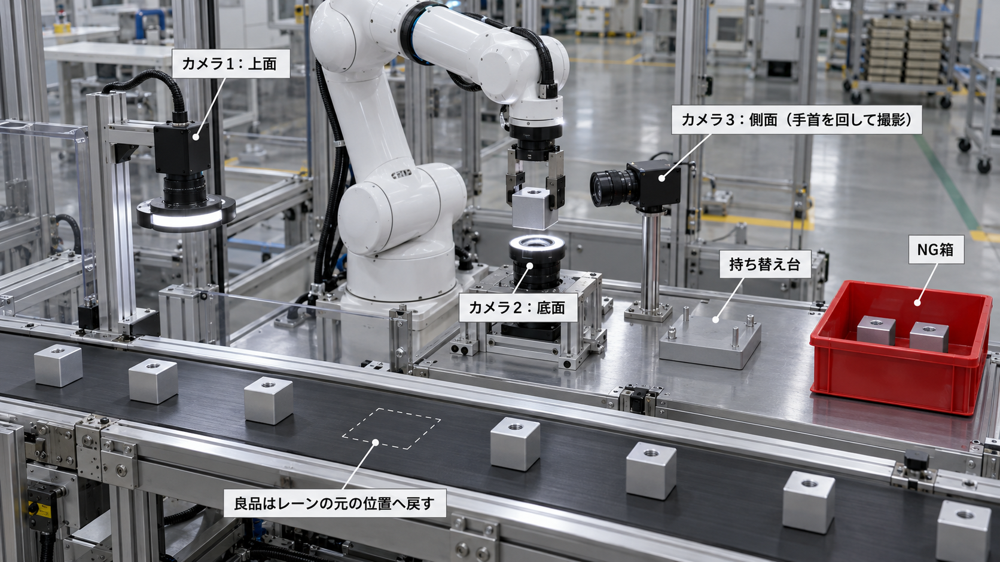

# ロボットによる6面外観検査ライン：持ち替えで「つかんだ面」まで見る（MuJoCo シミュレーション）

Physical AI 応用編1 最終課題。

精密切削工場の出荷前工程を想定し、アルミ削り出しのセンサーハウジング（40 mm 角、ねじ穴 1 か所）の
**6面全数外観検査**を、コンベア・カメラ3台・ロボットアーム1台で自動化するラインを MuJoCo 上に構築しました。



## 対象と業務

| 項目 | 内容 |
|---|---|
| 対象部品 | アルミ A6061 削り出しのセンサーハウジング。40 mm 角、上面に取付ねじ穴 1 か所 |
| 工程 | 切削・洗浄後、梱包前の最終外観検査（全数） |
| 不良 | 打痕・傷、油ジミ（洗浄残り）、角欠け。6面のどこにでも出る |
| 判定 | 1面でも不良なら NG 箱へ。良品はレーンに戻して梱包工程へ流す |

## ラインの流れ（1個あたり）

1. 部品がレーンを流れてくる。**カメラ1（レーン上の上面カメラ）**が通過中に上面を撮る。
2. レーンが停止位置で止まり、アームが部品の左右（±x面）をつかんで持ち上げる。レーンはすぐ再始動する。
3. 検査台で **カメラ2（下カメラ・リング照明）**が底面を撮り、**カメラ3（横カメラ1台）**が手前の側面を撮る。
   手首（第7関節）だけを180°回して、反対側の側面も同じカメラ3で撮る。
4. 持ち替え台に置き、**90°回してつかみ直す**。指で隠れていた2面を、カメラ3と手首の180°回転で撮る。
5. 6面すべて良なら、**動いているレーン上の元の位置**へ追従して戻す。どこかが NG なら NG 箱へ。
   不良が見つかった時点で残りの撮影を打ち切る。

カメラは上面・底面・側面の3台だけです。側面4面は手首の回転と持ち替えで1台のカメラに向けます。
処理能力を上げるときはカメラを増やさず、同じアームを並べて部品を分担する前提で試算しました。

## 評価

10ロット×8個＝80個（うち不良30個）を、同じ部品・同じ不良で各方式に流しました（`scripts/evaluate_lane.py`）。

| 方式 | 不良品の検出率 | 上面以外にだけ不良がある部品 | 良品の誤NG | 処理能力（1台） |
|---|---|---|---|---|
| 上面だけ（カメラ1のみ） | 20% | 0% | 0% | 5.7 個/分 |
| 持ち上げのみ（持ち替えなし） | 77% | 71% | 0% | 4.5 個/分 |
| **6面（持ち替えあり）** | **100%** | **100%** | 0% | 3.2 個/分 |

追加実験として、良品の画像だけで作る異常検知（`sortbot/anomaly.py`）を分類器に重ねました。
分類器が角欠けを学習していない場合、ラインでの角欠けの検出は 20% から 80% に上がりました。
代わりに良品の誤NGが 16% 出たため、本ラインの判定は分類器のみとしています。

図は `results/`、詳しい説明は `report/report.pdf` にあります。

## ROS 2 での実行

撮影するライン側と判定AIを、ROS 2 の2つのノードに分けて動かせます。

```
conveyor_line ──/inspection/image (sensor_msgs/Image)──▶ inspector
conveyor_line ◀──/inspection/verdict (std_msgs/String)── inspector
conveyor_line ──/joint_states, /line/status, /line/result──▶
```

macOS では RoboStack で ROS 2 Humble を入れました。

```bash
CONDA_SUBDIR=osx-arm64 conda create -n pai_ros -c conda-forge -c robostack-humble python=3.11 ros-humble-ros-base pytorch torchvision
conda activate pai_ros && pip install mujoco pillow imageio
bash ros2/run_demo.sh classifier      # 判定に異常検知を使うときは anomaly
```

## 再現手順

```bash
python3 -m venv .venv && ./.venv/bin/pip install -r requirements.txt
./scripts/setup_menagerie.sh                          # Panda モデルを取得
./.venv/bin/python scripts/test_lane.py 3             # 正解を使った判定でラインの動作確認
./.venv/bin/python scripts/gen_lane_dataset.py 2000 8 # 学習用の面画像を合成（約2分）
./.venv/bin/python scripts/train_classifier.py 6      # 分類器を学習（Apple M シリーズの MPS で約10分）
./.venv/bin/python scripts/train_classifier.py 3 chip # 角欠けを学習しない分類器（未知の不良の実験用）
./.venv/bin/python scripts/gen_line_good.py 40 8      # ラインに良品を流して画像を集める（異常検知用）
./.venv/bin/python scripts/train_anomaly.py           # 良品だけで異常検知を作る
./.venv/bin/python scripts/evaluate_lane.py 10        # 10ロット×8個で方式を比較
./.venv/bin/python scripts/make_figures.py            # 図を作成
./.venv/bin/python scripts/make_lane_demo.py          # デモ映像（2倍速）を記録
./.venv/bin/python scripts/make_video.py out/lane_demo.mp4 out/video.mp4  # 提出用の動画にまとめる
./.venv/bin/python report/build.py report/report.pdf  # 説明資料を PDF にする
```

macOS（Apple Silicon）、Python 3.11、MuJoCo 3.17 で動作確認しました。

## ディレクトリ

```
sortbot/lane.py          ライン（コンベア・カメラ3台・検査台・持ち替え台・NG箱・部品8個）の構築と状態
sortbot/lane_routine.py  ロボットの検査プログラム（上面→持ち上げ→底面・側面→持ち替え→側面→仕分け）
sortbot/lane_dataset.py  面画像の合成（ラインと同じカメラ・姿勢＋照明や位置のランダム化）
sortbot/judge.py         学習済み分類器による面ごとの判定
sortbot/anomaly.py       良品だけで作る異常検知（追加実験）
ros2/                    ROS 2 ノード（ライン、判定AI）と起動スクリプト
report/                  説明資料（HTML と PDF の生成スクリプト）
sortbot/cell.py, env.py  部品形状・不良の定義、共通の補助関数
scripts/                 動作確認・データ生成・学習・評価・図・デモ映像
results/                 評価結果（JSON・図）
concept/                 構想図
research/report.md       6面検査の先行事例と検証方法の調査メモ
```

## 前提と限界

- **把持の補助**：指で挟んだ後は、部品を手先に固定（溶接拘束）して運びます。
  接触だけで保持すると、シミュレーション上で部品が指の間を滑ったためです。検査の流れと判定を主題とするための簡略化です。
- 学習も評価もシミュレーションの合成画像です。実機では金属面の反射や照明、微小な傷への対応（sim-to-real）が課題になります。
- 複数アームの処理能力は、1台の実測サイクルとレーン搬送能力からの試算です。
- 構想図（`concept/`）と先行事例の調査（`research/report.md`）には生成AIを使いました。コードの作成にもAIアシスタントを使っています。

## ライセンス

本リポジトリのコードは MIT License。`third_party/` に取得する MuJoCo Menagerie の Panda モデルは Apache-2.0 です。
